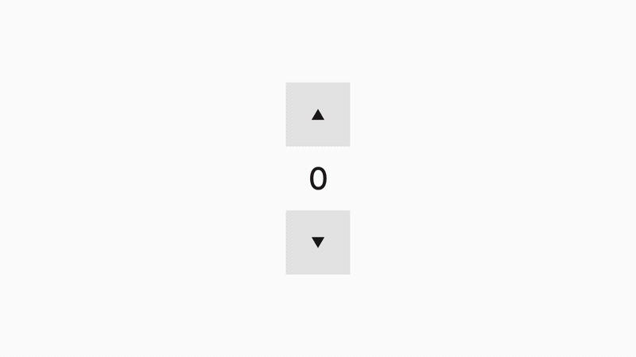
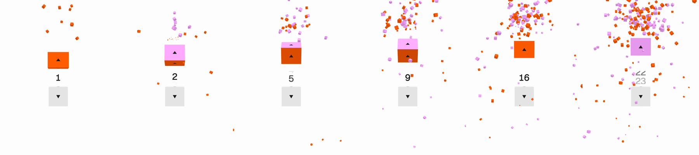

# Cube stepper

A number stepper where every button is a real 3D box. Press up and the box rolls a quarter turn, hops, lands with a squash and throws a handful of small cubes. Hold it down and the steps speed up until the screen fills with confetti.

**Try it: [cube-stepper.vercel.app](https://cube-stepper.vercel.app)**



## Why I made it

Steppers are some of the most boring controls in any interface, and I wanted to make one more playful than they usually are, without making it any harder to use. It's still an up button, a number and a down button. The arrow keys work and a screen reader hears "Increase", "Decrease" and the new value. The rest is just fun to press.

## What makes it feel right

- **It rolls forever on four faces.** A box has only four faces on the ring it turns through, but every step gets its own colour. Each face is repainted just before it rolls into view, alternating orange and pink, so the count can climb as high as you like and the box never runs out of sides. Leave it alone for a moment and it rolls back to gray.
- **Everything is a spring.** The roll, the hop, the squash and the shake are springs stepped once per frame. The roll is slightly underdamped, so each quarter turn lands a hair past square and settles back. How hard it lands feeds the squash, so a fast hold hops higher and lands harder.
- **Holding speeds up like a real stepper.** One step, a 380ms pause, then repeats that get 12% quicker each time, down to one every 35ms. The faster it goes, the more cubes each step throws.
- **Down at zero says no.** The down box shakes sideways instead of rolling, and the count never goes negative.
- **The number rolls with the box.** The old digit leaves in the direction the box turned and the new one arrives from the other side, on an ease-out curve.
- **It looks flat until you touch it.** An orthographic camera maps one world unit to one CSS pixel, so a resting button is a plain flat square, and the 3D only appears once it moves.
- **The confetti is one draw call.** Up to 220 cubes live in a single `InstancedMesh` with gravity, spin and a 1.1 second life.

## How it's built

- **Three.js and vanilla TypeScript on Vite.** One canvas and three DOM nodes don't need a framework.
- **The canvas is decoration; the controls are real buttons.** The WebGL scene is `aria-hidden`. Real `<button>`s sit exactly over the cubes, the number is an `<output aria-live="polite">`, and ArrowUp and ArrowDown work from anywhere on the page.
- **The loop sleeps.** The render loop runs only while something is moving, so an idle page draws nothing and costs no GPU.
- **Reduced motion is respected.** With `prefers-reduced-motion`, the boxes change colour without rolling, nothing hops, and no confetti flies.
- **Lighting is a flat front light plus a key light from above.** The front faces keep their true colour and the tops and undersides shade, which is what makes the boxes read as boxes. Three's lights are physically based, so the intensities are multiplied by π.

```
src/cube.ts        StepperCube: the roll, hop, squash and shake, all on springs
src/particles.ts   Bits: the instanced confetti cubes
src/main.ts        wiring: hold-to-repeat, keys, the number roll, the sleeping render loop
```

## Tested the way a person uses it

Most UI tests press keys because that's one line of code. The bugs here lived in the pointer path, so the scripts drag and hold for real:

- `scripts/verify.mjs` holds the cubes with a real pointer, then uses the keys, in Chromium and WebKit.
- `scripts/render-checks.mjs` catches what the eye catches and the interaction tests don't. It renders the resting state at 31 viewport heights and fails if the arrow's pixel coverage swings by more than 6%, which is how an arrow-flicker bug got caught and fixed. It also fails if a resting button isn't a perfect square.
- `scripts/record.mjs` drives the page on a virtual clock and renders the demo video frame by frame at 1920 by 1080, 60fps, so the recording never drops a frame.



## Run it

```bash
pnpm install
pnpm dev                          # http://127.0.0.1:5197
node scripts/verify.mjs           # interaction tests, Chromium and WebKit
node scripts/render-checks.mjs    # pixel checks
pnpm build
```

Made by [Andreas Kruszakin](https://andreas.vision), design engineer. More experiments at [andreas.vision/play](https://andreas.vision/play) and on [X](https://x.com/andreaskruszaki).
